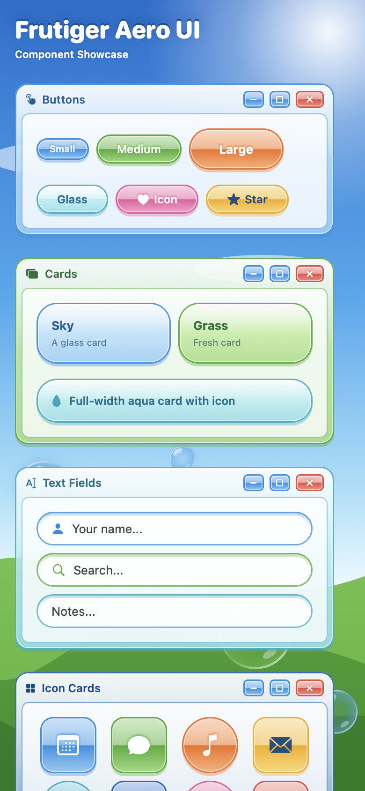
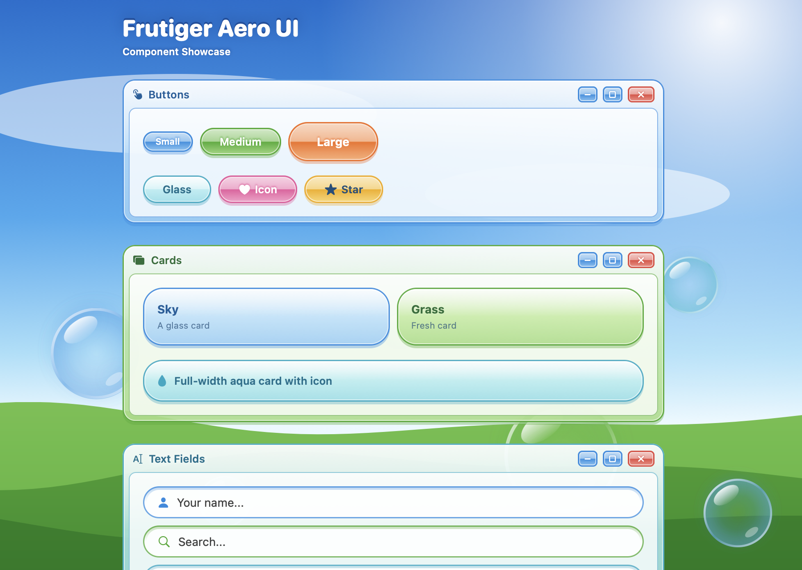

# 🫧 FrutigerAeroUI

A glossy SwiftUI component library for iOS and macOS, inspired by the **Frutiger Aero** aesthetic of the 2000s: glass, bubbles, aqua gradients, bright skies and green hills. Same structure and API style as [babyUI](https://github.com/Wilton-Garcia/babyUI), with a completely different look.

<br>

<p align="center">
  
  &nbsp;
  
</p>

---

## Requirements

- iOS 15.0+
- macOS 12.0+
- Swift 6.0+
- Xcode 16+

---

## Installation

### Swift Package Manager

In Xcode, go to **File → Add Package Dependencies** and enter the repository URL:

```
https://github.com/Wilton-Garcia/frutigerAeroUI
```

Or add it manually to your `Package.swift`:

```swift
dependencies: [
    .package(url: "https://github.com/Wilton-Garcia/frutigerAeroUI", from: "1.0.0")
],
targets: [
    .target(
        name: "YourApp",
        dependencies: ["frutigerAeroUI"]
    )
]
```

---

## Color System

Every component accepts an `AeroColorPalette`. Only `border` (deep edge) and `background` (light glass tint) are required; the mid tone (`accent`) is derived automatically. frutigerAeroUI ships with 12 built-in palettes:

| Name | Preview |
|------|---------|
| `AeroColors.skyBlue` | Bright sky |
| `AeroColors.ocean` | Deep water |
| `AeroColors.aqua` | Turquoise glass |
| `AeroColors.grass` | Fresh green |
| `AeroColors.lime` | Spring lime |
| `AeroColors.sunshine` | Sunny yellow |
| `AeroColors.orange` | Clownfish orange |
| `AeroColors.coral` | Warm red |
| `AeroColors.pink` | Candy pink |
| `AeroColors.purple` | Soft violet |
| `AeroColors.pearl` | Clear white glass |
| `AeroColors.silver` | Brushed metal |

You can also create a custom palette:

```swift
let myPalette = AeroColorPalette(
    border: Color(hex: "#1D8BE0"),
    background: Color(hex: "#C4EAFF")
)

// Optionally control the mid tone and the text color used on solid surfaces
let custom = AeroColorPalette(
    border: Color(hex: "#F2A900"),
    background: Color(hex: "#FFF0A8"),
    accent: Color(hex: "#FFD54A"),
    foreground: AeroColors.ink
)
```

---

## Components

### AeroButton

A glossy pill button with filled or glass style, three sizes, and optional leading icon. Reacts to presses.

```swift
// Default filled
AeroButton("Click me!", palette: AeroColors.skyBlue) {
    print("tapped")
}

// Glass with icon
AeroButton("Favorite", systemImage: "heart.fill", palette: AeroColors.pink, style: .outlined) {
    print("favorited")
}

// Sizes: .small, .medium (default), .large
AeroButton("Large", palette: AeroColors.grass, size: .large) {}
```

---

### AeroCard

A frosted glass container with a soft highlight. Accepts any SwiftUI view as content.

```swift
AeroCard(palette: AeroColors.skyBlue) {
    VStack(alignment: .leading) {
        Text("Hello!")
            .font(.headline)
        Text("This is a card.")
            .font(.subheadline)
    }
}

// Custom padding
AeroCard(palette: AeroColors.grass, padding: 24) {
    Label("Leaf", systemImage: "leaf.fill")
}
```

---

### AeroTextField

A glass-pane text input with an optional leading icon. Glows when focused.

```swift
@State private var name = ""
@State private var query = ""

AeroTextField("Your name...", text: $name, systemImage: "person.fill", palette: AeroColors.skyBlue)

AeroTextField("Search...", text: $query, systemImage: "magnifyingglass", palette: AeroColors.grass)

// Without icon
AeroTextField("Notes...", text: $name, palette: AeroColors.aqua)
```

---

### AeroIconCard

A glossy app-icon tile displaying an SF Symbol. Available as a rounded square or a round orb.

```swift
AeroIconCard(systemImage: "calendar", palette: AeroColors.skyBlue)

AeroIconCard(systemImage: "music.note", palette: AeroColors.orange, size: .large, shape: .orb)

// Sizes: .small (60pt), .medium (80pt, default), .large (100pt)
// Shapes: .square (default), .orb
```

---

### AeroBadge

A small glossy capsule for counts, status indicators, or short text.

```swift
AeroBadge("New", palette: AeroColors.grass)
AeroBadge("42", palette: AeroColors.coral)
AeroBadge("Beta", palette: AeroColors.purple)
```

---

### AeroTag

A glass pill label, optionally removable with an `×` button.

```swift
// Static
AeroTag("SwiftUI", palette: AeroColors.skyBlue)

// Removable
AeroTag("iOS", palette: AeroColors.grass, onRemove: {
    tags.removeAll { $0 == "iOS" }
})
```

---

### AeroToggle

A glossy switch with a glass orb knob, wrapped in a glass card.

```swift
@State private var isEnabled = true

AeroToggle("Wi-Fi", isOn: $isEnabled, palette: AeroColors.grass)
```

---

### AeroProgressBar

A glossy progress bar inside a glass tube. Value ranges from `0.0` to `1.0`.

```swift
AeroProgressBar(value: 0.7, palette: AeroColors.grass)

// Custom height
AeroProgressBar(value: 0.4, palette: AeroColors.skyBlue, height: 12)
```

---

### AeroDivider

An etched separator: a colored line that fades at the edges, with a white highlight below.

```swift
AeroDivider(palette: AeroColors.aqua)
```

---

### AeroWindow

A Windows-Vista-style glass window with a title bar, caption buttons and a bright content pane.

```swift
AeroWindow("My Computer", systemImage: "desktopcomputer", palette: AeroColors.skyBlue) {
    VStack(alignment: .leading) {
        Text("Welcome to the future")
        AeroProgressBar(value: 0.6)
    }
}
```

---

### AeroBubble

A decorative soap bubble with specular highlights.

```swift
AeroBubble(size: 80, palette: AeroColors.aqua)
```

---

### AeroBackground

The classic wallpaper: bright sky, sun glare, clouds, rolling green hills and floating bubbles. Fills the whole screen.

```swift
ZStack {
    AeroBackground()
    // your content
}

// Without bubbles
AeroBackground(showsBubbles: false)
```

---

### AeroSurface

The primitive every component is built on. Use it to build your own glossy views from any `InsettableShape`.

```swift
Text("Custom")
    .padding()
    .background {
        AeroSurface(Capsule(style: .circular), palette: AeroColors.aqua, style: .glass)
    }

// Style: .solid (default), .glass
// Gloss: .split (default, hard-edged highlight), .soft (fading highlight for tall shapes)
```

> Tip: prefer `Capsule(style: .circular)` over `Capsule()` when stroking, since the default continuous style can render stray edge artifacts on some platforms.

---

## Showcase

frutigerAeroUI ships with an `AeroUIShowcase` view that renders all components in a single scrollable screen over the Aero wallpaper. Useful for quick visual reference during development:

```swift
import frutigerAeroUI

struct ContentView: View {
    var body: some View {
        AeroUIShowcase()
    }
}
```

| iPhone | macOS |
|:------:|:-----:|
|  |  |

---

## Spacing & Radius Tokens

| Token | Value |
|-------|-------|
| `AeroSpacing.xs` | 4pt |
| `AeroSpacing.sm` | 8pt |
| `AeroSpacing.md` | 16pt |
| `AeroSpacing.lg` | 24pt |
| `AeroSpacing.xl` | 32pt |

| Token | Value |
|-------|-------|
| `AeroRadius.small` | 8pt |
| `AeroRadius.medium` | 14pt |
| `AeroRadius.large` | 22pt |
| `AeroRadius.extraLarge` | 30pt |

---

## License

MIT
